# Informe de auditoría · Core financiero de la COOPAC Santa Rosa

**SI-084 · Auditoría de Sistemas · Examen práctico de Unidad I**

| Dato | Valor |
|---|---|
| Apellidos y nombres | COMPLETAR |
| Código de estudiante | COMPLETAR |
| URL del repositorio | https://github.com/COMPLETAR/si084-caso-coopac/tree/examen-u1 |
| Fecha de ejecución | COMPLETAR |
| Corte evaluado | 31/12/2025 |

> RESULTADOS VERIFICADOS: P1–P7 fueron ejecutados en Docker y los nueve archivos TXT fueron sellados mediante SHA-256. Falta completar los datos personales, la URL del repositorio e insertar las capturas antes de entregar.

## 1. Objetivo, alcance y metodología

El objetivo de la auditoría es determinar si el servidor de base de datos del core financiero cumple las siete reglas aprobadas por el Consejo de Administración, con corte al 31 de diciembre de 2025. El alcance comprende la configuración del contenedor PostgreSQL, los roles de base de datos, las cuentas del core, los desembolsos y los mecanismos de respaldo y restauración incluidos en el paquete del caso.

Se aplicaron inspección de configuración, consultas SQL, análisis de datos y una prueba de restauración. Los resultados se contrastan con la *Política de seguridad del core financiero*, versión 2.0 (COOPAC Santa Rosa, 2024). Cada conclusión debe quedar respaldada por una salida de terminal almacenada en `evidencias/` y por el manifiesto de integridad `SHA256SUMS.txt`.

## 2. Resultados de los procedimientos

Los criterios y códigos de control se reproducen de la política interna versión 2.0 (COOPAC Santa Rosa, 2024).

| Regla | Resultado, con cifras | ¿Cumple? | Archivo de evidencia |
|---|---|---|---|
| R1 | La configuración original publica 55432 hacia 5432 sin restringir IP, lo que la expone en todas las interfaces. Por un conflicto local con otro proyecto, la prueba se ejecutó en 0.0.0.0:55433, manteniendo el mismo tipo de exposición; la evidencia conserva ambos datos. | No | evidencias/P1_puertos.txt |
| R2 | Contraseña en texto plano en docker-compose.yml, línea 10; tiene 10 caracteres, frente al mínimo de 12. Se omite su valor. | No | evidencias/P2_credenciales.txt |
| R3 | La consulta de roles confirmó que app_core posee el atributo Superuser, además de postgres. | No | evidencias/P3_roles.txt |
| R4 | 16 cuentas activas de 10 personas cesadas; cese más antiguo: 18/12/2015. Hay 22 cuentas activas sin documento, 4 con perfil ADMIN. | No | evidencias/P4_cesados.txt; evidencias/P4_genericas.txt |
| R5 | 23 desembolsos superiores al umbral registrados y aprobados por el mismo usuario; total S/ 709 370,47 y 21 usuarios distintos. | No | evidencias/P5_segregacion.txt |
| R6 | PostgreSQL devolvió log_connections=off y log_statement=none; la política exige on y mod. docker-compose.yml confirma la misma configuración. | No | evidencias/P6_registro.txt |
| R7 | El último respaldo es del 14/11/2025, 47 días antes del corte. La restauración creó únicamente empleados (96 filas) y usuarios (118 filas); desembolsos no existe. El log registra falta de espacio desde el 15/11/2025. | No | evidencias/P7_respaldos.txt; evidencias/P7_restauracion.txt |

Condición de P5:

```sql
monto > umbral_aprobacion AND usuario_registra = usuario_aprueba
```

“Supera” implica estrictamente mayor; no se incluyen montos iguales al umbral. Las cifras deben contrastarse con las consultas sobre el servidor.

## 3. Hallazgo 1

| Elemento | Contenido |
|---|---|
| Título | Desembolsos por S/ 709 370,47 sin aprobación independiente |
| Condición | 23 desembolsos superiores al umbral tienen el mismo registrador y aprobador, por S/ 709 370,47, realizados por 21 usuarios. La evidencia consta en evidencias/P5_segregacion.txt, con resumen y detalle. |
| Criterio | La regla R5 establece que un desembolso que supera el umbral no puede ser aprobado por quien lo registró. La política vincula este requisito con el control A.5.3, Segregación de funciones (COOPAC Santa Rosa, 2024). |
| Causa | La definición de desembolsos en bd/01_core.sql no incorpora una restricción CHECK que impida monto superior al umbral con registrador igual al aprobador, y datos/desembolsos.csv contiene esa combinación. El paquete no permite determinar las validaciones de una aplicación externa. |
| Efecto | S/ 709 370,47 se procesaron sin aprobación independiente, con riesgo de desembolsos indebidos o errores no detectados. Es el monto afectado por el incumplimiento, no una pérdida o fraude demostrado. |
| Recomendación | El Jefe de Sistemas y el responsable de Créditos deben implementar en 5 días hábiles una validación de aprobador distinto, tanto en el flujo como en la base. Créditos debe revisar y documentar la regularización de los 23 casos en 10 días hábiles. |

## 4. Hallazgo 2

| Elemento | Contenido |
|---|---|
| Título | Respaldos incompletos y 47 días sin respaldo satisfactorio al corte |
| Condición | El último archivo es core_2025-11-14.sql, 47 días anterior al 31/12/2025. La restauración confirmó las tablas empleados y usuarios y la ausencia de desembolsos. Las evidencias constan en evidencias/P7_respaldos.txt y evidencias/P7_restauracion.txt. |
| Criterio | La regla R7 exige un respaldo diario completo que incluya desembolsos y una prueba trimestral de restauración. La política vincula este requisito con el control A.8.13, Respaldo de la información (COOPAC Santa Rosa, 2024). |
| Causa | respaldos/respaldo.sh usa --exclude-table=desembolsos. Su comentario atribuye la exclusión a una decisión del Jefe de Sistemas del 01/11/2025 para reducir el tiempo. respaldos/respaldo.log registra “No space left on device” desde 15/11/2025 hasta el corte. |
| Efecto | El respaldo disponible no permite recuperar desembolsos y no cubre los 47 días posteriores al último respaldo satisfactorio. Existe riesgo de interrupción operativa y pérdida de registros, sin que se haya demostrado una pérdida efectiva. |
| Recomendación | El Jefe de Sistemas debe resolver la falta de espacio y retirar la exclusión en 24 horas; generar un respaldo completo y probarlo en una base separada dentro de 48 horas. Debe implantar alertas diarias de fallos y capacidad y documentar pruebas trimestrales de todas las tablas. |

## 5. Conclusión

La ejecución de P1–P7 determinó que el servidor incumple las siete reglas evaluadas. Los riesgos prioritarios corresponden a la ausencia de aprobación independiente en desembolsos y a la imposibilidad de recuperar completamente el core desde el último respaldo disponible.

## 6. Referencias

COOPAC Santa Rosa. (2024, 15 de marzo). *Política de seguridad del core financiero* (versión 2.0) [Política interna].

COOPAC Santa Rosa. (2025). *Caso de auditoría del core financiero* [Conjunto de datos y archivos de configuración].

## 7. Capturas

Las capturas complementan los archivos TXT y no los sustituyen.

### Inicio y configuración

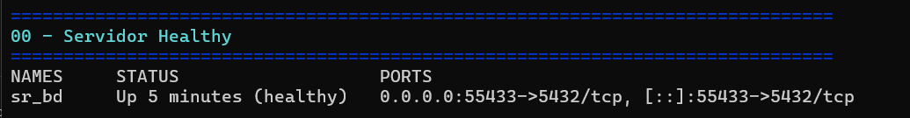

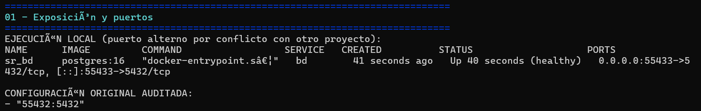

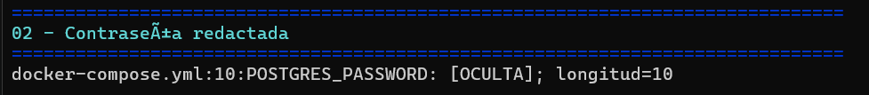

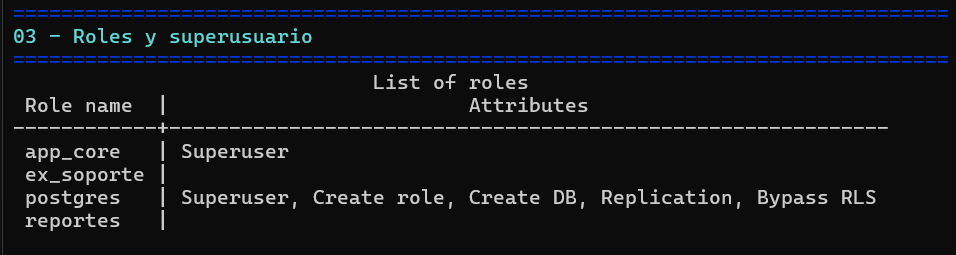

### Identidades y segregación de funciones

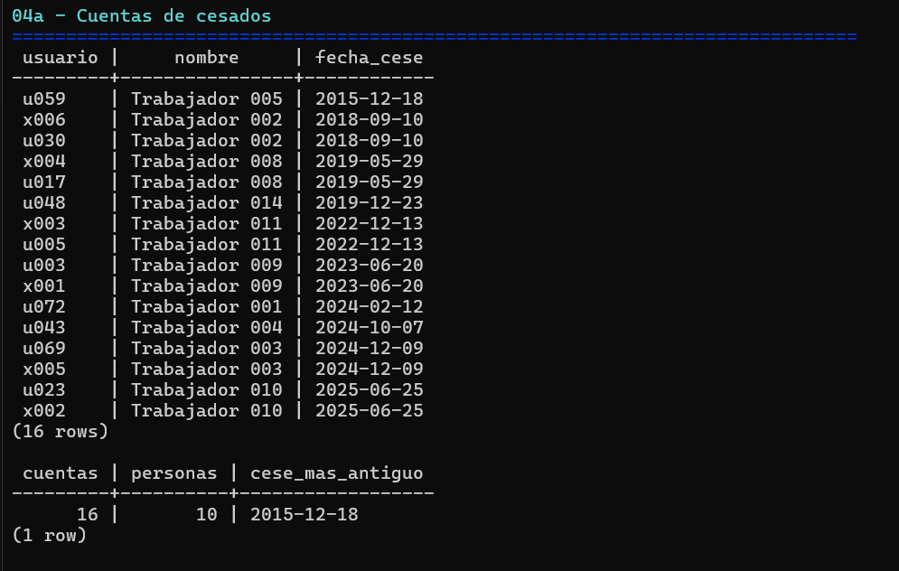

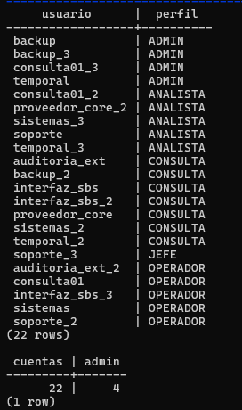

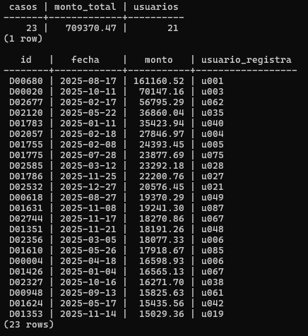

### Registro respaldo e integridad

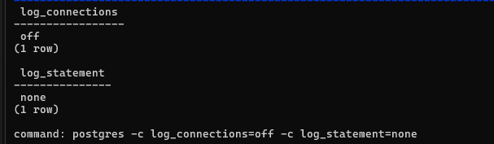

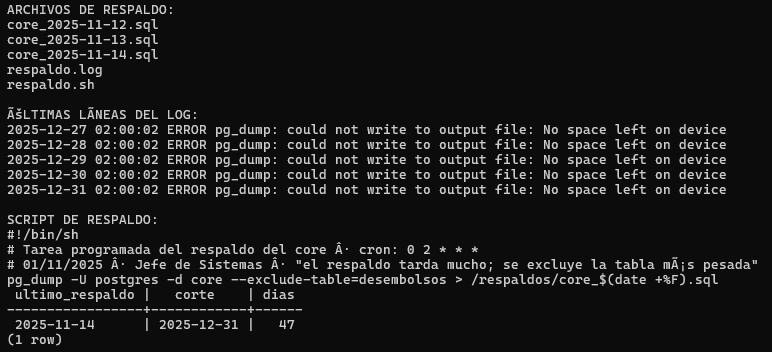

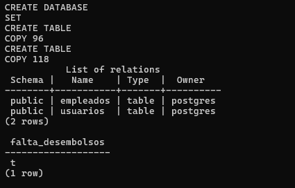

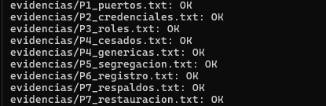
